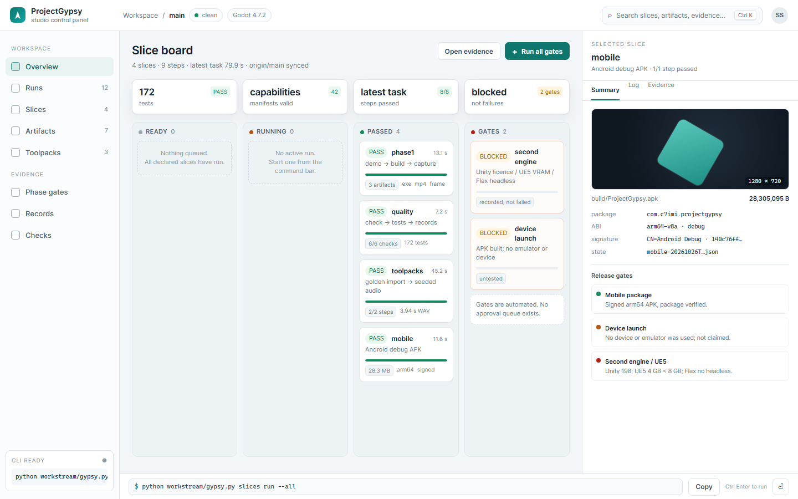
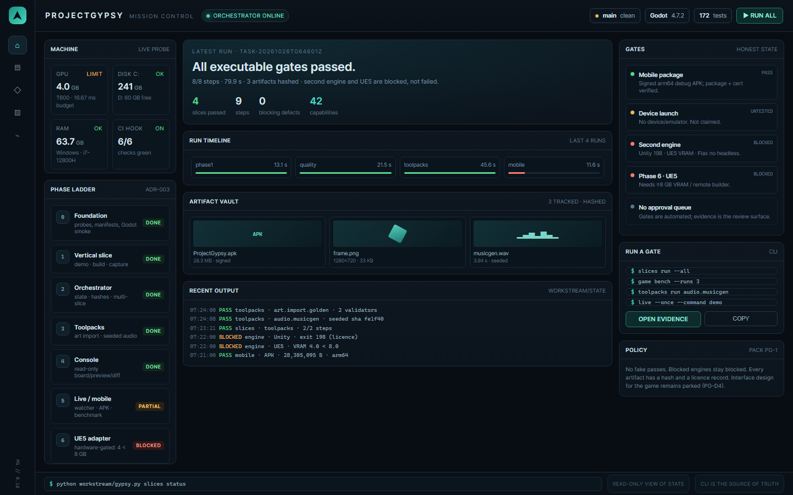
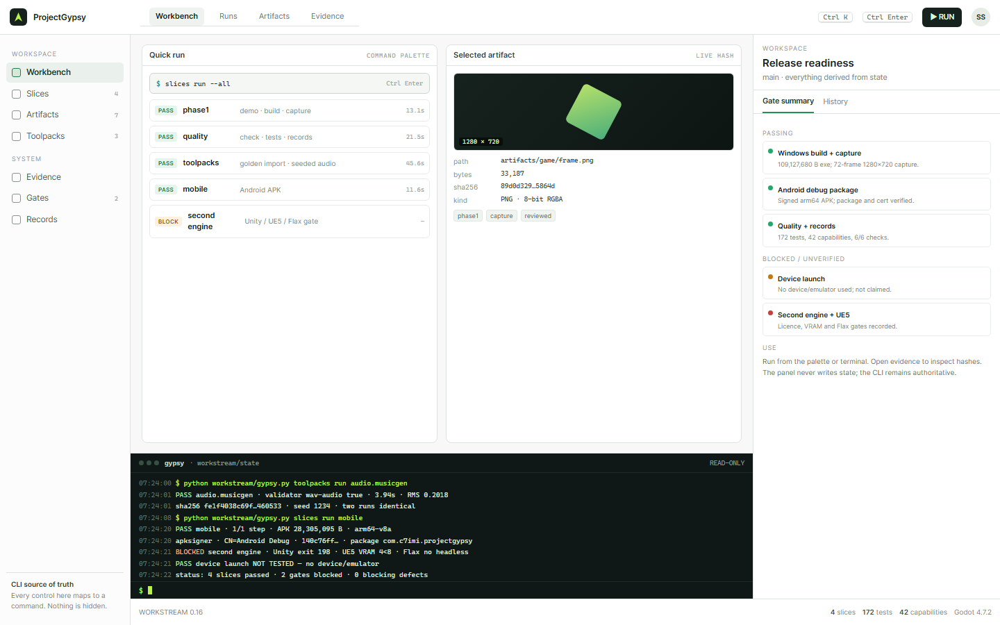
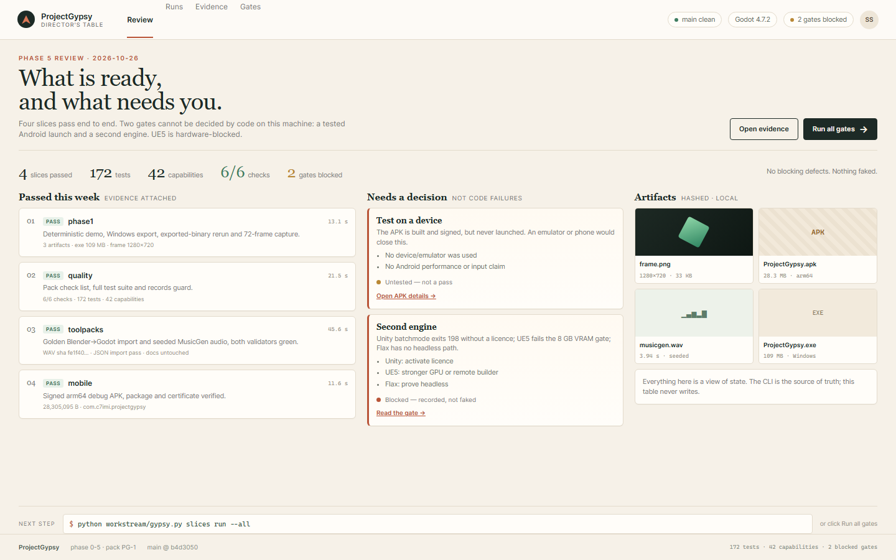

# ProjectGypsy control panel — mockups

**Status: implemented as one local dark app.** The four directions are combined in the local dashboard ([docs/DASHBOARD.md](../../docs/DASHBOARD.md), ADR-014); Studio Board is the default. The PNGs here remain the design exploration; the maintained app lives in design/dashboard. The game's own interface standard is still parked (PG-D4); this is tooling, not the game UI. Nothing here is wired into the workstream
yet.

## Short answer: do you need a GUI?

**No to execute. Yes to manage.** The workstream is CLI-first and every result already has a command and a JSON/state
record. A GUI is useful for oversight — seeing the slice board, opening artifact hashes, spotting blocked gates, and
launching a run without remembering flags.

If a GUI is built, it should be a **local-only control panel**:
- reads workstream/state, slices/, artifacts and git; writes only on an explicit action;
- every button shows the exact command it runs;
- no separate approval workflow (none exists); gates are automated;
- no server exposed beyond 127.0.0.1; no telemetry;
- CLI remains the source of truth; the GUI adds presentation, not hidden capability.

## The four directions

| Version | Best for | Emphasizes |
| --- | --- | --- |
| 1. Studio Board (light) | Everyday default | Slice board, step progress, artifact inspector, command bar |
| 2. Mission Control (dark) | Watching long autonomous runs | Machine health, phase ladder, gates, recent output, run controls |
| 3. Command Hybrid | Power users | Command palette, terminal log, live artifact hash, minimal chrome |
| 4. Director's Table | Operator review | "What is ready / what needs you", decisions, evidence, no terminal required |

### 1. Studio Board

The safest default: a familiar board where all four slices pass, blocked gates are clearly separated from failures, and
the selected artifact shows size, package, signature and state. The bottom command bar exposes the exact CLI command.

### 2. Mission Control

A status wall for long runs: machine limits (GPU 4 GB, disk, RAM), phases 0–6, the latest run timeline, artifact vault and
the honest gate panel. Best when the system is running unattended and you want to glance at health and blockers.

### 3. Command Hybrid

For someone who prefers the terminal: command palette, recent output, selected artifact and release readiness in one
screen. It looks closest to how the workstream actually works and is the least likely to hide state.

### 4. Director's Table

For review rather than execution: large "passed this week" evidence and a "needs a decision" column. It deliberately
keeps the blocked gates (device launch, second engine) visually separate from failures.

## Recommendation

Start with **Studio Board** as the default, borrow Mission Control's **phase/gate strip**, and offer Director's Table as a
read-only "review mode". Command Hybrid can be the power-user view, but it is essentially a styled terminal and adds the
least beyond the existing CLI.

A practical build order:
1. Read-only board + artifact preview + gate panel (no actions).
2. Add explicit "Run all", "Re-run slice", "Open evidence" actions that print their command and require confirmation.
3. Add live update from state files and a desktop shell (Tauri/Electron) or a 127.0.0.1-only local server.

Do not build the GUI before choosing the shell: desktop app, local browser page, or terminal TUI are different products
with different maintenance costs.

## How to use it today (CLI)

From the repository root, in PowerShell:

    . .\tools\tool-env.ps1                         # only if a long-running shell has an old PATH
    python workstream/gypsy.py engines probe
    python scripts/check_all.py
    python workstream/gypsy.py console board
    python workstream/gypsy.py slices run --all
    python workstream/gypsy.py game verify
    python workstream/gypsy.py game bench --runs 3
    python workstream/gypsy.py toolpacks run audio.musicgen
    python workstream/live.py --paths game --once --command demo
    powershell -File scripts/build_android.ps1

Useful read-only views:

    python workstream/gypsy.py console board
    python workstream/gypsy.py console preview artifacts/game/frame.png
    python workstream/gypsy.py console diff
    python workstream/gypsy.py slices status

Evidence lives in [../../docs/PHASE-1-EVIDENCE.md](../../docs/PHASE-1-EVIDENCE.md),
[../../docs/PHASE-2-EVIDENCE.md](../../docs/PHASE-2-EVIDENCE.md),
[../../docs/PHASE-3-EVIDENCE.md](../../docs/PHASE-3-EVIDENCE.md),
[../../docs/PHASE-4-EVIDENCE.md](../../docs/PHASE-4-EVIDENCE.md),
[../../docs/PHASE-5-EVIDENCE.md](../../docs/PHASE-5-EVIDENCE.md) and
[../../docs/PHASE-6-GATE.md](../../docs/PHASE-6-GATE.md).

## Regenerating the mockups

Open any .html file directly in a browser, or render with Edge:

    msedge --headless --disable-gpu --hide-scrollbars --window-size=1440,900 --screenshot=out.png file:///.../01-studio-board.html

The PNGs are checked in; the HTML is the editable source.
