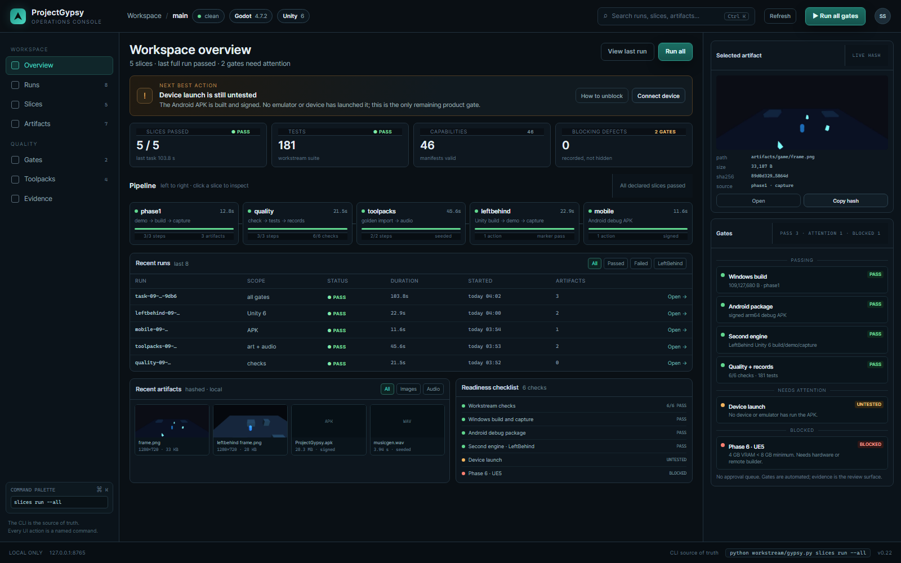
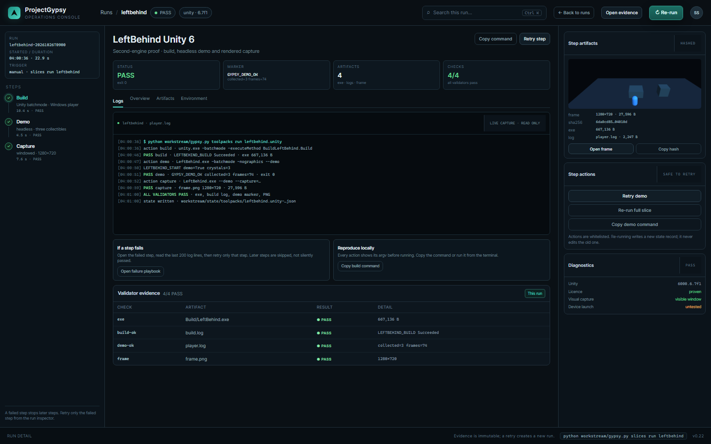

# Dashboard redesign — operations console

The implemented operations console for the local ProjectGypsy dashboard. It is the default at `/`; the original
four-view app remains available at `/classic`.

## Why the old default screen was hard to use

- Two board columns (Ready/Running) take half the width even when empty.
- Gates mix “untested”, “blocked” and “passing”, so the important distinction is buried.
- The default screen has no “what should I do next?” answer.
- There is no run history, no run-detail view, and no visible retry/error path.
- Few controls have a clear consequence; the current inspector is mostly passive.
- At five slices the kanban no longer scales; it will get worse with more slices.

## Structure

### 1. Workspace overview — overview.png

- **Next best action** at the top, with an explanation and an action.
- **Metrics** that answer “did it pass, how much is proven, what needs attention?”.
- **Pipeline strip** with one stage per slice, status, duration and artifact count.
- **Recent runs table** with scope, status, duration, start time and a way in.
- **Recent artifacts** and a **readiness checklist** fill the lower area instead of leaving dead space.
- Right rail keeps **selected artifact** and **gates**, grouped as Passing / Needs attention / Blocked.
- Gates explicitly say there is no approval queue; evidence is the review surface.

### 2. Remaining console screens — live-mission.png, live-commands.png, live-review.png, live-slices.png, live-artifacts.png

- Mission: phase ladder, machine, engine posture, grouped gates.
- Commands: the fixed whitelist with argv, run/copy and latest job output.
- Review: release readiness, evidence and checklist; no approval queue.
- Slices: table of declared slices with run/open actions.
- Artifacts: hashed artifact library with live previews.

### 3. Run detail — run-detail.png

- Left: run metadata and ordered step timeline.
- Center: status, marker, artifact count, validator count; log with real argv; **failure playbook**; **reproduce locally**.
- Bottom: **validator evidence** table proving the marker, build, demo and PNG.
- Right: step artifacts with hashes, **retry / re-run / copy command**, and diagnostics.
- The design distinguishes “evidence is immutable” from “a retry creates a new run”.

## Design rules

1. **One primary decision per screen.** The overview's next action is the first thing to read.
2. **Never mix gate states.** Passing, needs-attention and blocked are separate groups with different treatments.
3. **Every number is actionable.** A slice, run or artifact is clickable; static metrics are avoided.
4. **Commands stay visible.** Action buttons map to explicit argv; a copy-command affordance is always nearby.
5. **Robust states are first-class:** empty, loading, stale, running, failed and blocked all get explicit UI. A failed
   step gets a retry and a log path, not a silent red badge.
6. **No fake approval.** Automated gates + evidence; no invented approval queue.
7. **Read-only evidence.** Retries create new state; old evidence is never rewritten.
8. **Scale by rows, not columns.** A runs table and a pipeline strip keep working past five slices.
9. **Responsive fallback:** below 1200 px, the right rail moves under the main column and the pipeline becomes a
   two-row grid; below 760 px, the rail collapses and runs become stacked cards.

## What is implemented

- Backend: `GET /api/runs` returns newest-first run summaries; `GET /api/run?id=...` returns steps, artifacts and
  validators; `/api/state` now includes `runs`. Run IDs are state paths, path-checked under `workstream/state`.
- Frontend: `/` uses `design/dashboard-v2/index.html`, `app.css` and `app.js`; overview is the default, run rows open
  the run-detail view, and the original four-view app is served at `/classic`.
- Actions: new fixed whitelist entries `leftbehind`, `leftbehind_build`, `leftbehind_demo`, `leftbehind_capture`; all UI
  actions still go through the existing confirmation and token-protected POST `/api/run`.
- Retry buttons map to real commands; no per-step argv is accepted from the browser.
- Data comes from task/slice/toolpack state; no second evidence model.
- Localhost-only and token protections remain.

## Current data used in the mockups

5 slices (phase1, quality, toolpacks, leftbehind, mobile) · 182 tests · 46 capabilities · 2 gates needing attention
(device launch untested, UE5 hardware-blocked) · LeftBehind Unity 6 PASS.

Live screenshots: `live-overview.png` and `live-run.png`.
