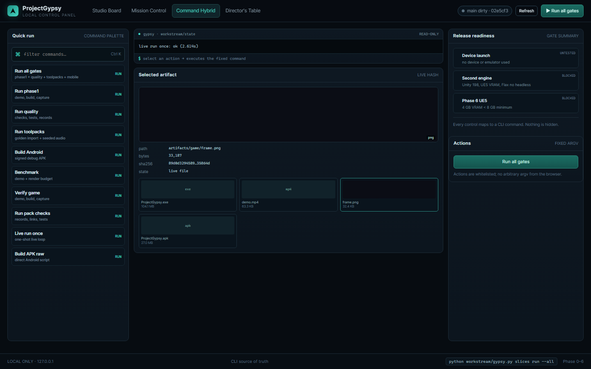
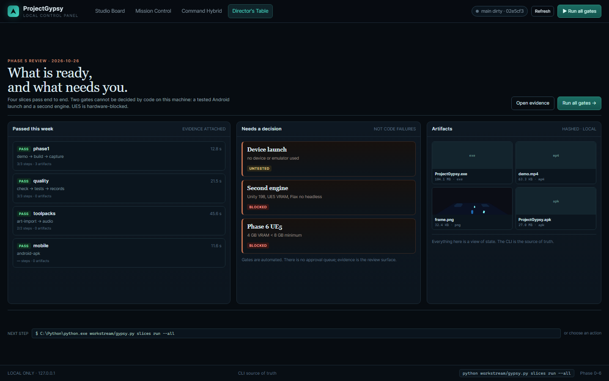

# Local dashboard

A dark, local-only GUI over the workstream. Start it from the repository root:

    python workstream/gypsy.py dashboard

It opens http://127.0.0.1:8765/ in your default browser. Use --no-open to suppress the browser, or --port N to change
the port. Stop with Ctrl+C. The server binds 127.0.0.1 only.

## Views

| View | What it is for |
| --- | --- |
| Studio Board (default) | Board of slices, step progress, artifact preview/hash, release gates, run actions |
| Mission Control | Machine health, phase ladder 0-6, run timeline, artifact vault, recent output, gates |
| Command Hybrid | Command palette, terminal output, selected artifact, gate summary |
| Director's Table | Review mode: passed slices, what needs a decision, artifacts, next command |

All four are views of the same state; the selected tab is remembered in localStorage and can be deep-linked with
?view=studio, ?view=mission, ?view=hybrid or ?view=director.

## Actions

Buttons run the same commands as the CLI, after a confirmation that shows the exact argv:

| Button | Command |
| --- | --- |
| Run all gates | python workstream/gypsy.py slices run --all |
| Run phase1 / quality / toolpacks | slices run <id> |
| Build Android | slices run mobile |
| Benchmark | game bench --runs 3 |
| Verify game | game verify |
| Run pack checks | python scripts/check_all.py |
| Live run once | live --paths game --once --command demo |
| Build APK raw | scripts/build_android.ps1 |

One action at a time; output appears in the job drawer and is polled until completion. The drawer links to the latest
Phase-5 evidence. Actions are a fixed server-side whitelist; the browser never sends argv.

## Safety

- 127.0.0.1 only, no remote binding.
- Per-process token on POST /api/run, localhost Origin check.
- CSP, no external scripts/assets, anti-framing headers.
- Artifact and doc serving is path-checked and restricted to build/, artifacts/, docs/ and design/.
- No arbitrary shell, no approval queue, no hidden writes; state is written by the CLI commands themselves.

## Limits

- No authentication or multi-user model; it is a local tool.
- The browser is a presentation layer; if it is closed the CLI still works.
- PNG previews are live files; board sizes come from state and may be stale between refresh/polls.
- Not packaged as a desktop binary; it is a local Python server plus static assets.
- Game interface design remains parked (PG-D4); this dashboard is developer tooling only.

## Source

- Server: workstream/dashboard.py
- App: design/dashboard/app.css, app.js, index.html
- Tests: workstream/tests/test_dashboard.py
- Decision: ADR-014
