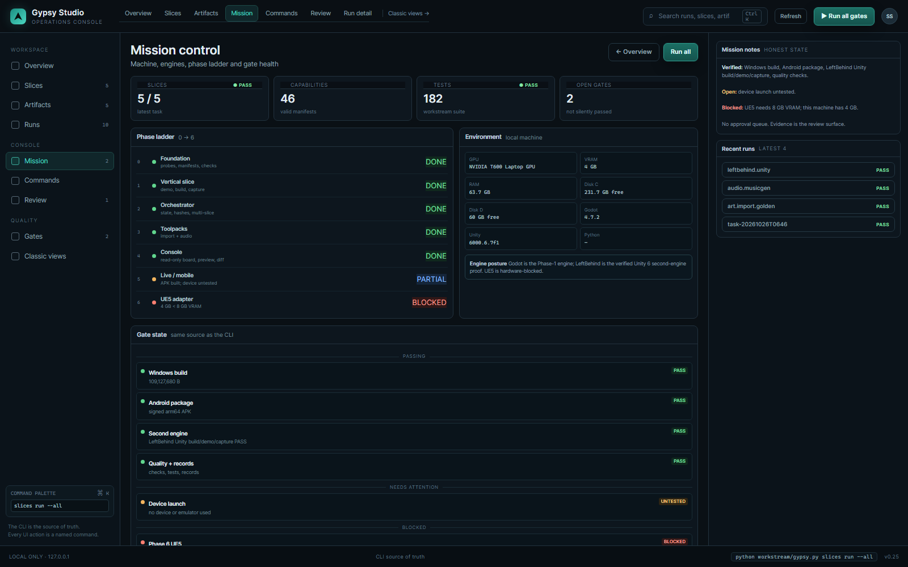
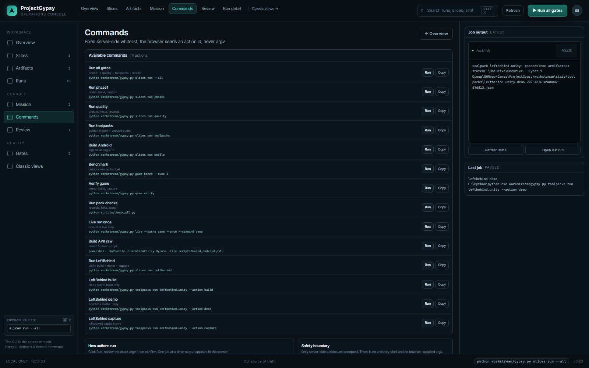
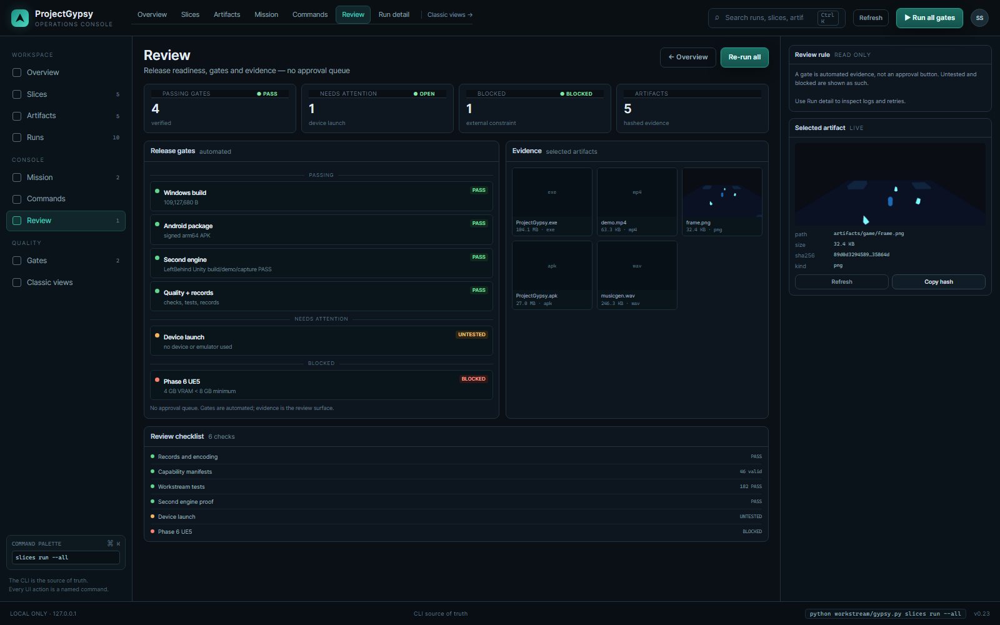
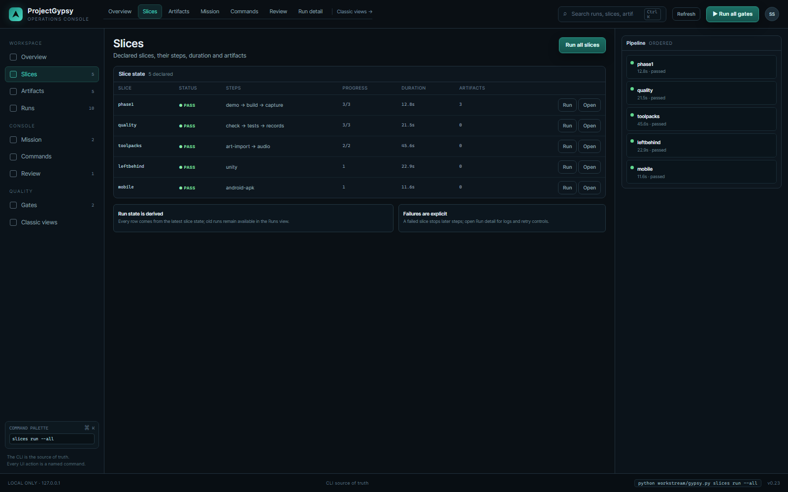
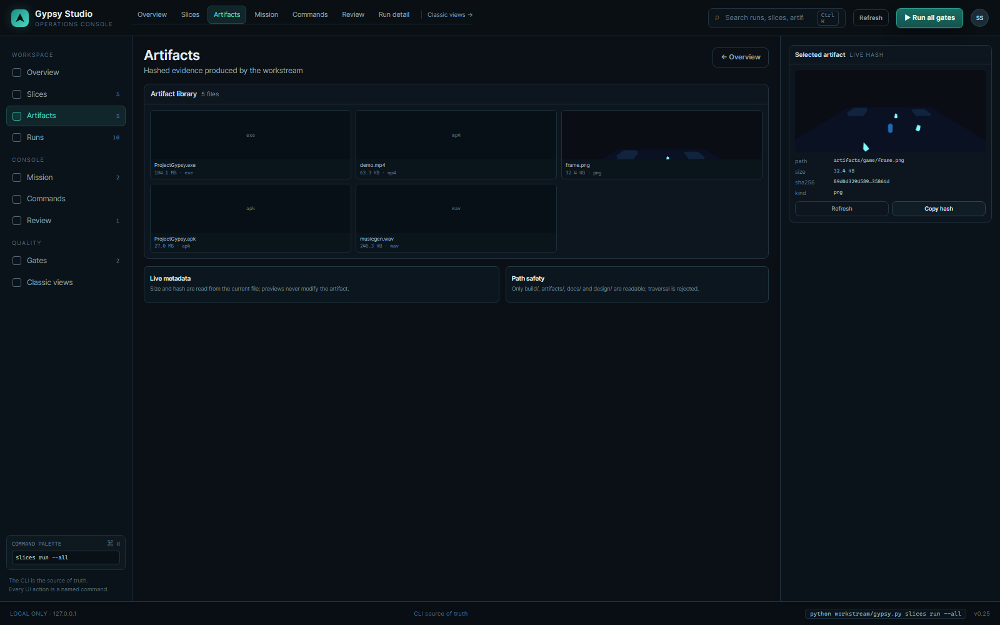
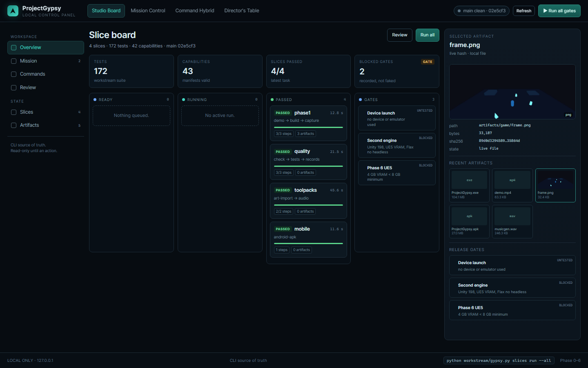
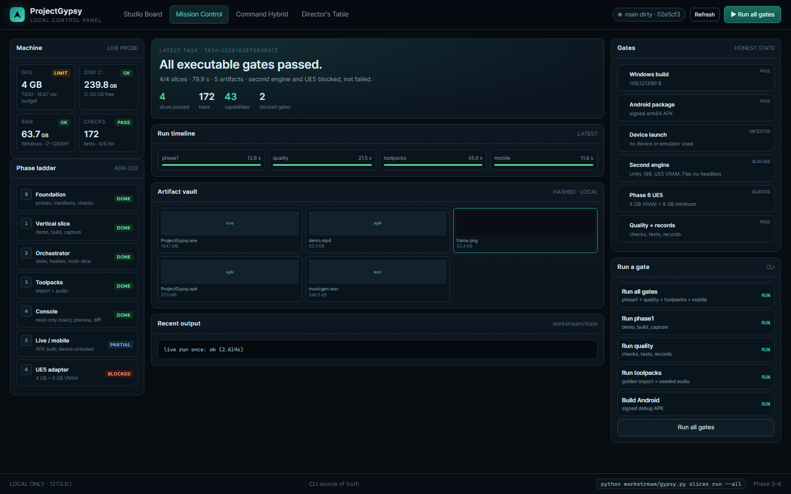

# Gypsy Studio dashboard

A dark, local-only GUI over the workstream. Start it from the repository root:

    python workstream/gypsy.py dashboard

It opens http://127.0.0.1:8765/ in your default browser. Use --no-open to suppress the browser, or --port N to change
the port. Stop with Ctrl+C. The server binds 127.0.0.1 only.

## Views

| View | What it is for |
| --- | --- |
| **Overview** (default) | Next best action, pipeline, recent runs, artifacts, readiness checklist, grouped gates |
| **Insights** | Plain-language engine/default, last-run health, quality/gates, cache, scheduler, run metrics, asset registry and next actions |
| **Projects** | Read-only project catalog: engine/version, targets, manifest health, paths; no filesystem browsing |
| **Run detail** | Step timeline, log, validator evidence, artifacts, retry/re-run controls |
| **Slices** | Slice table, step progress, duration, artifacts; run/open actions |
| **Artifacts** | Hashed artifact library with live previews and metadata |
| **Mission** | Machine, phase ladder, engine posture and gate health |
| **Commands** | Fixed command whitelist with argv, run/copy actions and latest job output |
| **Review** | Release readiness, grouped gates, evidence and checklist — no approval queue |
| Studio Board (`/classic`) | Original four-view app: board, preview/hash, gates, run actions |
| Mission Control (`/classic`) | Machine health, phase ladder 0-6, run timeline, artifact vault, recent output, gates |
| Command Hybrid (`/classic`) | Command palette, terminal output, selected artifact, gate summary |
| Director's Table (`/classic`) | Review mode: passed slices, what needs a decision, artifacts, next command |

The operations console is deep-linkable with `?view=overview`, `?view=insights`, `?view=slices`, `?view=artifacts`,
`?view=mission`, `?view=commands`, `?view=review`, `?view=projects` or `?view=run`; run detail opens the newest run and can be selected from any run row. Ctrl/⌘+K focuses search; tablist arrow keys move between views.
The original four views remain at `/classic` and keep their studio/mission/hybrid/director tabs and localStorage selection.

Classic views:

## Actions

Buttons run the same commands as the CLI, after a confirmation that shows the exact argv:

| Button | Command |
| --- | --- |
| Run all gates | python workstream/gypsy.py slices run --all |
| Run phase1 / quality / toolpacks | slices run <id> |
| Build Android | slices run mobile |
| Benchmark | game bench --runs 3 |
| Verify game | game verify |
| Run pack checks | python scripts/check_all.py |
| Live run once | live --paths game --once --command demo |
| Build APK raw | scripts/build_android.ps1 |
| Run LeftBehind | slices run leftbehind |
| LeftBehind build / demo / capture | toolpacks run leftbehind.unity --action <id> |

One action at a time; output streams into the job drawer via SSE (`/api/logs/stream`) with `/api/job` polling fallback.
Failures include a copyable command, a retry action and a run link. Actions are a fixed server-side whitelist; the browser
never sends argv.

## State API

- `GET /api/state` — slices, artifacts, gates, phases, machine, metrics, commands and run summaries.
- `GET /api/insights` — plain-language insights model used by the Insights view.
- `GET /api/logs/stream` — live job output SSE; `/api/job` remains the polling fallback.
- `GET /api/catalog` — project catalog payload, or a 503 with an error when the scan fails; manifest health only, not
  engine/build readiness. The browser cannot choose a filesystem root.
- `GET /api/metrics` — state-derived run/cache/quality metrics (`gypsy.metrics/v1`).
- `GET /api/assets` — read-only asset registry (`gypsy.asset-registry/v1`) with hashes, duplicates and provenance warnings.
- `GET /api/runs` — newest-first run summaries from task and toolpack state.
- `GET /api/run?id=...` — one run's steps, artifacts and validators; the id is a state path under workstream/state.
- `GET /api/job` — current job output; `POST /api/run` starts a whitelisted action.
- `GET /api/artifact?path=...` — metadata; add `raw=1` for bytes.

The operations console and the classic four views are separate surfaces: `/` is the default, `/classic` preserves the original four-view app.

## Safety

- 127.0.0.1 only, no remote binding.
- Per-process token on POST /api/run, localhost Origin check.
- CSP, no external scripts/assets, anti-framing headers.
- Artifact and doc serving is path-checked and restricted to build/, artifacts/, docs/ and design/.
- No arbitrary shell, no approval queue, no hidden writes; state is written by the CLI commands themselves.

## Limits

- No authentication or multi-user model; it is a local tool.
- The browser is a presentation layer; if it is closed the CLI still works.
- PNG previews are live files; board sizes come from state and may be stale between refresh/polls.
- Not packaged as a desktop binary; it is a local Python server plus static assets.
- Game interface design remains parked (PG-D4); this dashboard is developer tooling only.

## Source

- Server: workstream/dashboard.py (serves `/` from design/dashboard-v2; `/classic` from design/dashboard)
- App: design/dashboard-v2/app.css, app.js, index.html
- Classic app: design/dashboard/app.css, app.js, index.html
- Tests: workstream/tests/test_dashboard.py
- Decision: ADR-014
