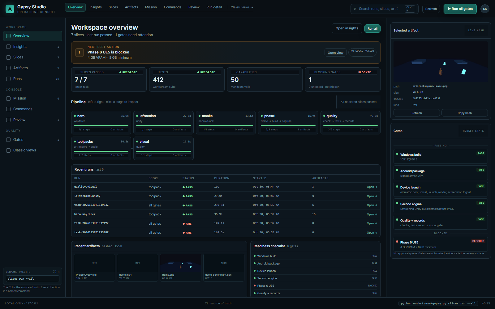
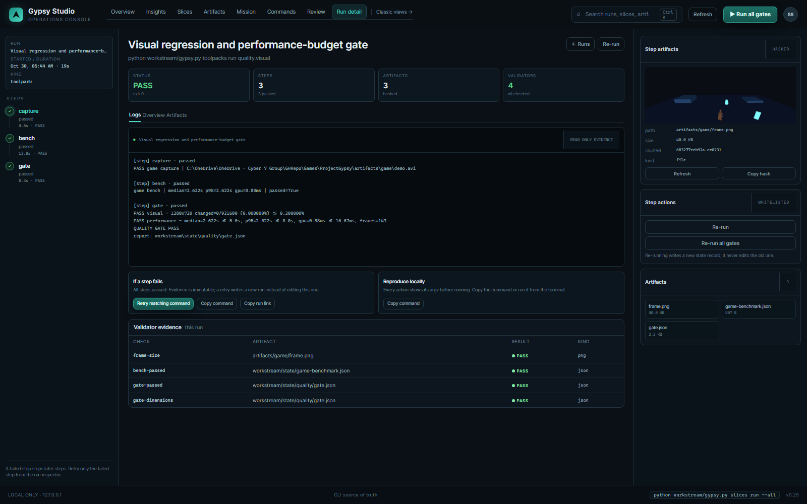

# Gypsy Studio upgrade report — 2026-10-30

## Result

The software-buildable P0 upgrades from [IMPROVEMENT-ROADMAP.md](IMPROVEMENT-ROADMAP.md) are implemented and verified.
The complete slice set passes: **7/7 slices, 12/12 steps, 276.385 s**. The dashboard was rebuilt and captured with
Chromium. The Android emulator launch and Unity hero import are now real evidence, not untested claims.

## What was built

- **Content-addressed action cache** (workstream/cache.py): SHA-256 inputs/artifacts, platform/tool/version keys,
  atomic blob store, stats, clear; opt-in per action/step; only passing actions cached; hits restore artifacts and skip
  commands; toolpack hits re-run validators. Real hit: hero validation **0.0 s vs 0.188 s**.
- **Opt-in parallel execution**: bounded 1–8 worker scheduler, deterministic result ordering, pending-only cancellation,
  state fields; CLI --parallel N, --no-cache, --force.
- **Visual/performance gates** (workstream/quality.py, scripts/quality_gate.py): tracked baseline,
  changed-pixel ratio, dimension check, performance budgets; opt-in visual slice. Real result: changed 0/921600,
  median 2.811 s, p95 2.811 s, GPU 0.87 ms, 143 frames, PASS.
- **Project catalog** (workstream/catalog.py, gypsy catalog, /api/catalog): read-only health, duplicates,
  optional state; Unity/Godot golden-path templates.
- **Dashboard UX**: Insights view, cache/scheduler cards, live logs via SSE with polling fallback, actionable failures,
  honest empty states, keyboard/focus/responsive improvements.
- **Android emulator proof**: Gypsy_API35b boot, APK install, activity launch, rendered scene, screenshot/logcat.
  Host-GPU workaround for the SwiftShader shader-link failure. Evidence: [DEVICE-LAUNCH.md](DEVICE-LAUNCH.md),
  [DEVICE-EVIDENCE.json](DEVICE-EVIDENCE.json), [evidence/device-game.png](evidence/device-game.png).
- **Unity hero import proof**: batchmode import of wayfarer.fbx, **23 bones**, idle/run/reach, Smile, 4 materials,
  512×512 atlas/normal, height 1.9055 m. Evidence:
  [evidence/unity-hero-import-report.json](evidence/unity-hero-import-report.json).
- **Reliability**: extension temp-cleanup hardened with ignore_cleanup_errors; Unity capture retry on missing frame.
- **Docs/records**: ADR-019, updated Phase-5/UNITY-SLICE/IMPORT-MATRIX/DASHBOARD/README/AGENTS/workstream README,
  slices/toolpacks README, BuildNotes 2026.10.30.007, Retrace 41.

## Verification

| Check | Result |
| --- | --- |
| Full unit suite | **505 tests OK (3 skipped)** (412 at P0, 456 after remote cache, 505 after assets/metrics) |
| check_all | **6/6 PASS** |
| All slices | **PASS** — hero 35.9 s, leftbehind 27.5 s, mobile 13.6 s, phase1 16.7 s, quality 79.5 s, toolpacks 84.3 s, visual 19.1 s |
| Visual gate | PASS — 0/921600 changed; median 2.811 s; p95 2.811 s; GPU 0.87 ms; 143 frames |
| Cache | hit 0.0 s vs 0.188 s miss; stats/list/clear tested |
| Emulator | PASS — boot 36.013 s, install Success, cold launch 8.513 s, renderer NVIDIA T600, 0 Godot errors/fatal |
| Unity import | PASS — UNITY_HERO_IMPORT_OK bones=23, 16 checks |
| UI | Chromium 1600×1000 screenshots: live-overview.png, live-insights.png, live-run.png |

## UI review

The reviewed operations console now shows **Overview**, **Insights**, Slices, Artifacts, Runs, Mission, Commands,
Review, Gates and classic views. Insights explains the engine default, last-run health, quality/gates, cache and
scheduler in plain language. Cache card is state-derived and honest when empty; device launch now shows PASS with the
emulator scope.

## P1 increment (same day)

- **Authenticated loopback remote action cache** (ADR-020): fresh local cache miss **0.178 s**, then a fresh second
  state directory **0.0 s remote hit**, restoring artifacts/hero/validation.json; server 1 entry/1 blob/2 puts/2 gets.
- **Projects dashboard view**: real catalog (ProjectGypsy Godot 4.7.2, LeftBehind Unity 6000.6.7f1), health/paths,
  read-only scan and copy actions; Chromium screenshot live-projects.png.
- Slice-step cache cwd made checkout-relative so the same cache descriptor can match across different absolute checkout
  roots.
- Full suite after this increment: **456 tests OK (3 skipped)**.

## P1 increment: assets and metrics

- **Asset registry**: 30 assets, 9,255,627 bytes, 3 roots, 7 duplicate-content groups, 1 provenance warning, 0 errors.
- **Metrics**: 11 task runs (9 pass, 2 fail), median 26.564 s, p95 276.385 s; 7/7 slices; 89 toolpack actions;
  cache 1 hit / 7 misses / 7 stores; quality gate passed; problems [].
- **UI/API**: Insights cards for run metrics and asset registry; /api/assets and /api/metrics; full suite **505 tests**.
- ADR-021 documents both as read-only views, not build proof.

## P1 increment: provenance and SBOM

- **Signed provenance**: 3 real artifacts (frame.png, wayfarer.glb, ProjectGypsy.exe), HMAC-SHA256, verify PASS,
  key fingerprint sha256:11232c0e..., key gitignored and never embedded.
- **SBOM**: 152 components / 155 relationships, deterministic, manifest-derived.
- **Surfaces**: provenance sign/verify/sbom CLI, /api/provenance, Insights Provenance + SBOM card.
- **Honesty**: local symmetric integrity, not PKI; no certificates, external identity, timestamp authority or legal
  clearance. Full suite **529 tests**.

## P1 increment: asset dependency graph

- **31 nodes, 3 declared edges, 28 roots, 30 leaves, 2 layers, 0 cycles.**
- Explicit hero edges: base GLB → LOD1/LOD2/FBX, each with a basis from the generator/ADR-017; no inferred edges.
- Budgets: image 2.81 MB / 10 MB; model 6.38 MB / 10 MB; text 70.6 KB / 1 MB; all OK.
- CLI `asset-graph`, API `/api/asset-graph`, Insights Asset graph card; 25 graph tests; full suite **554 tests**.

## Remaining external gates (not software-buildable here)

The following remain **blocked by hardware, accounts/spend, or a missing upstream capability**. They are not silently
claimed as done:

1. **Physical Android device** pass; touch/input, audio, rotation, suspend/resume, on-device performance and release
   signing. The emulator pass is explicitly not a physical-device pass.
2. **UE5** — 4 GB VRAM below the 8 GB declared minimum; no UE5 build claimed.
3. **Flax** — no demonstrated headless path.
4. **Generic Unity adapter / import matrix** — hero FBX import is proven; generic Unity import/build/mobile parity is
   still the Stage B migration in UltraBlade 2.
5. **Paid/account providers** — YuE2 24 GB class, SDXL/FLUX, TripoSR, Hyper3D/Meshy/Scenario/Runway, FMOD/Wwise, etc.
   require GPU, accounts, keys, spend/data-policy approval; not purchased or silently installed.
6. **Native MCP client** — DSH does not expose one; the existing bridge remains.

These are the only items left in [DEFERRED.md](../DEFERRED.md) plus the parked interface decision; all P0 software work
that could be built on this machine is done.

## Recommended next (P1)

Remote cache/workers, generic Unity adapter + mobile parity, device/emulator farm, Gauntlet-style session tests,
asset registry/USD/MaterialX/OCIO, OpenTelemetry/DORA, enforced agent leases and an agent evaluation suite, signed
artifacts/SBOM. See the roadmap.

## Commit

No commit/push was performed by subagents. Lead integration commit contains the upgrade and evidence.
